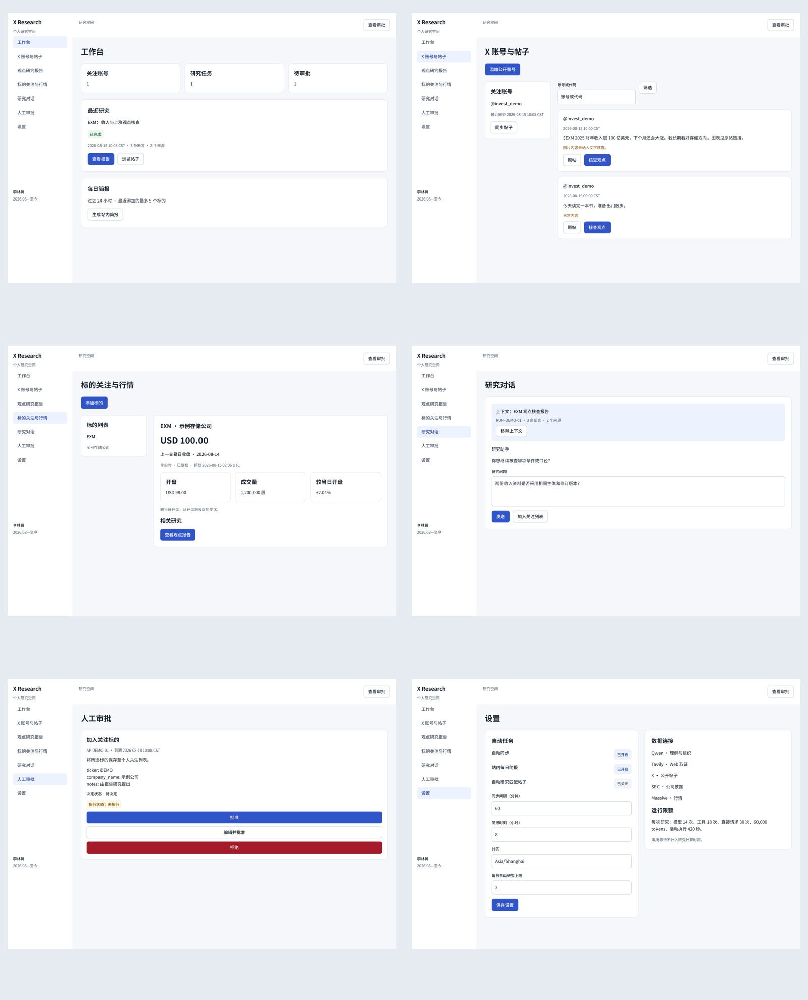

# X 投资观点研究助手

**李林翼 · 个人项目，使用 AI Coding 工具协作实现 · 2026.08—至今**

用户关注公开 X 账号，在混合帖子中选取一条投资观点，发起跨来源核查，阅读断言、支持与反对证据、来源和不确定性，再继续研究。产品不把所有帖子都当投资内容，也不把多数博主的一致观点当作事实证据。

## 一个项目，两个展示入口

| 入口 | 重点 | 建议阅读 |
|---|---|---|
| **[AI Agent 工程案例](docs/agent-case/README.md)** | 架构、Agent 工作流、MCP 工具、预算、持久化、审批、异常和真实验证 | 架构 → 工作流 → 验证与复现；[离线展示页](docs/agent-case/index.html) |
| **[AI 产品案例](docs/ai-product-case/README.md)** | 问题与需求、研究方法、优先级、PRD、交互、AI 评估、Figma 和可读性迭代 | [精简作品集 PDF](docs/ai-product-case/正式文档/精简求职作品集.pdf) → [PRD](docs/ai-product-case/原稿/05-产品需求规格PRD.md) → 原型与评估；[离线作品集](docs/ai-product-case/index.html) |

GitHub 可直接阅读 Markdown、查看图片和下载 PDF / DOCX。HTML 作品集与交互原型需下载 / clone 后离线打开；本仓库未部署 GitHub Pages。

## 当前实现

- React / TypeScript 七页工作台，FastAPI / SSE，独立 Worker 与 PostgreSQL 业务任务、事件、checkpoint 和长期 Store。
- LangChain create_agent 调用 DashScope Qwen；Runtime 注入运行上下文，Middleware 管理预算、来源登记、工具错误与 HITL。
- 本地 FastMCP 封装 X、SEC、Massive REST；Tavily 通过官方远程 MCP 提供 search / extract。
- 结构化断言报告，来源 ID 与引文定位规则、预测与意见区分、冲突证据、取消 / 部分结果 / 进程恢复。
- Chat 写入个人关注、观点、偏好及来源信任前须人工批准、编辑或拒绝；决策和实际执行分别记录。

Massive 显示上一交易日收盘 / 复权日线，保留日期、USD、单位和非实时口径；SEC 提供公司披露，Tavily 用于 Web 取证，Qwen 负责理解与组织。V1 不引入 RAG、向量库、OSS、MinerU 或多 Agent。

## 可核对的成果

| 验证 | 实际结果 | 时间与范围 |
|---|---|---|
| 受限真实研究 | 3 条断言、4 个来源、0 引文定位警告；32,657 tokens | 2026.10.08 的单次 NVDA 案例，不是事实准确率 |
| 真实人工审批 | 模型提议 → 重启保留同一审批 → 拒绝恢复，未执行写入 | 2026.10.08；批准 / 编辑在隔离库验证 |
| 历史回归 | 后端 20 项、可读性修订后浏览器 6 项通过 | 2026.10.08，详见 [原验收记录](docs/validation.md) |
| 本次安全复查 | 后端 10 passed / 10 skipped；Ruff 与生产构建通过 | 2026.10.10；不调用研究 API、不写业务数据库 |
| 产品设计 | 七页双端 Figma 原生设计、组件库与关键状态，可点击核心路径 | 产品目标设计；不是新增应用能力 |

详见 [工程验证](docs/agent-case/03-验证与复现.md) 与 [本次摘要](docs/agent-case/证据/本地验证摘要.json)。引文可定位不等于语义支持，预测不作为已证实事实。

## 产品材料与原型

- [完整产品文档 PDF](docs/ai-product-case/正式文档/完整产品交付文档.pdf) / [可编辑 DOCX](docs/ai-product-case/正式文档/完整产品交付文档.docx)。
- [离线可点击原型](docs/ai-product-case/原型/index.html)、[页面设计手册](docs/ai-product-case/页面设计手册.html)。
- [Figma 正式设计](https://www.figma.com/design/5satRUZqhVo53GQJXfttHw?node-id=17-2)、[桌面演示](https://www.figma.com/proto/5satRUZqhVo53GQJXfttHw?node-id=12-1270&page-id=5%3A6&starting-point-node-id=12%3A1270&scaling=scale-down-width&content-scaling=fixed)、[手机演示](https://www.figma.com/proto/5satRUZqhVo53GQJXfttHw?node-id=12-2747&page-id=5%3A6&starting-point-node-id=12%3A2747&scaling=scale-down-width&content-scaling=fixed)。
- [Figma 导出与说明](docs/ai-product-case/Figma设计/README.md)、[需求与验收追溯](docs/ai-product-case/证据/需求验收追溯.csv)、[评估体系](docs/ai-product-case/原稿/08-评估体系与结果分析.md)、[可读性迭代](docs/ai-product-case/原稿/10-可读性迭代案例.md)。



资料口径集中见 [案例资料说明](docs/ai-product-case/原稿/00-案例资料说明.md)：SIM-R / SIM-E 是方法演示，ACT-LOCAL 是夹具实际执行，ACT-REC 是历史真实记录。目标与代码对应见 [技术交付附录](docs/ai-product-case/原稿/12-技术交付附录.md)。图片理解、观点周报和外部推送不属于当前实现；本人负责核心需求、流程判断和自测反馈，实现与文档采用 AI Coding 协作，不夸大为外部用户研究或独立手写全栈。

## 本地启动

需要 Python 3.12—3.14、uv、Node.js 22+。首次自行配置自己的 `.env`，参考 [.env.example](.env.example)，已有文件不要覆盖。

```powershell
Copy-Item .env.example .env
# 在编辑器中填写自己的 API key 与 SEC_USER_AGENT。
uv sync --frozen
powershell -ExecutionPolicy Bypass -File scripts\start.ps1
```

打开 http://127.0.0.1:8765 。Windows 首次启动准备独立 PostgreSQL、执行迁移、安装并构建前端；本机数据库监听 55432，文件保存在忽略的 `.runtime`。本项目不提供用户的密钥、个人研究数据库或预装依赖。

```powershell
powershell -ExecutionPolicy Bypass -File scripts\stop.ps1
```

停止应用保留数据库；`-Database` 同时停止本项目数据库。`.env.local` 存放本地覆盖值，进程环境变量优先。必需来源配置为 DASHSCOPE_API_KEY / DASHSCOPE_BASE_URL / LLM_MODEL / TAVILY_API_KEY / X_BEARER_TOKEN / MASSIVE_API_KEY / SEC_USER_AGENT；SEC 联系身份由使用者自行提供。

默认本机单用户、单 Worker；非本机监听须配置 APP_AUTH_TOKEN。Dockerfile / compose 随仓库提供，历史未实际启动验收。完整复现、无付费测试和真实验收命令见 [验证与复现](docs/agent-case/03-验证与复现.md)。不要在 clone 后自动运行付费探测或审批批准。

## 目录与上传范围

```text
backend/                    FastAPI、Agent、供应商、Worker、迁移
frontend/                   React 页面、样式、构建与浏览器测试
tests/                      证据规则、审批持久化、X 同步、API 与迁移
scripts/                    启停、环境准备与显式真实验证
docs/agent-case/            AI Agent 工程展示入口
docs/ai-product-case/       AI 产品展示入口与正式材料
```

密钥、私人业务数据、原始日志、缓存和临时文件不进入 Git；不复制虚构的开发时间线。发布清单、历史检查和文件范围见 [仓库与发布范围](docs/agent-case/04-仓库与发布范围.md) 与 [上传质量检查](docs/agent-case/证据/上传质量检查.json)。
