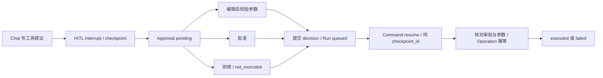

# 工作流与可靠性

## 单帖研究的执行链路

1. 用户添加公开 X 账号并同步混合文本帖子，不自动对所有帖子运行投资研究。
2. 用户选择具体帖子，API 建立 Run，记录 question / post_id / ticker 与 thread/checkpoint 关联。
3. Worker 设置 running，恢复已有 checkpoint 或写入本 Run 的唯一用户消息，注入 RunContext。
4. Qwen 调用受限读工具；Middleware 计数、记录工具事件、截断结果并将真实 Source 保存后再交给模型。
5. ToolStrategy 生成 ReportDraft；代码核对来源和引文，保存报告、Claim 与 Evidence。
6. 根据来源缺失与 unavailable_tools 决定 completed / partial。SSE 回放 RunEvent；断线不成为任务失败。

[API](../../backend/app/api.py)、[Worker](../../backend/app/worker.py)、[来源与预算服务](../../backend/app/services.py)、[报告](../../backend/app/reports.py)。通用研究接口有 request_key 幂等；单帖入口尚无同等跨刷新去重，属于目标方案增强。当前报告追问为文本，Figma 中携带上下文的按钮为目标交互。

## 人工审批及执行

四类写工具为 add_to_watchlist、save_thesis、update_investment_preferences、update_source_trust。研究模式不把这些写工具提供给模型。Chat 提议仅暂停，不等于写入；UI 批准 / 编辑 / 拒绝以后，Worker 用同 interrupt_id 和 action_index 顺序恢复。

审批提交锁定 Run，重复相同 decision 返回已有结果，不同 decision 返回 409；过期、取消或不在 awaiting_approval 时不能执行。编辑参数须通过对应 Pydantic schema。执行边界重新检查已提交的 approved / edited、实际参数一致性与 Operation key（run_id:tool_call_id），在业务事务中记录结果；拒绝设置 not_executed。工具执行错误与审批决策分开记录。

同 namespace/key 的 Store 写入是幂等 upsert，业务表和 Store 不是同一事务。外部只读请求在崩溃窗口仍可能重复计费。上述约束见 [approvals.py](../../backend/app/approvals.py)、[tools.py](../../backend/app/agent/tools.py) 与 [持久化测试](../../tests/test_agent_persistence.py)。

## 状态与恢复

| 场景 | 当前实现行为 | 检查入口 |
|---|---|---|
| queued / running | Worker 取任务并保存事件；启动时 running 重新排队，通过 checkpoint 与唯一消息 ID 继续 | worker.py |
| awaiting_approval | 保存 interrupt 和审批；重启保留同一动作；全部 decision 就绪后排队恢复 | approvals.py |
| partial | 预算或部分来源缺失时保留已有来源 / 可用结果；不是成功取证的同义词 | worker.py / reports.py |
| cancelled | API 标记取消；Worker 轮询并取消执行；未处理审批失效 | api.py / worker.py |
| failed / expired | 保存安全错误类型或超时状态，不把原始 SDK 异常当用户输出 | worker.py |
| Chat 取消 / 失败 / 部分 | 轮换会话 checkpoint，避免未完成工具周期污染下一轮 | worker.py |
| SSE 断线 | 使用事件 ID 游标回放已持久事件；执行仍归 Worker | api.py / tests/test_api.py |
| X 同步中断 | 保存固定下界与下一页 token；增量完整后推进 since_id；部分错误不跳过新帖 | x_sync.py / tests/test_x_sync.py |
| X 原帖不可访问 | 保守撤回相关报告、对话和 checkpoint；不继续展示旧正文 | x_sync.py / tests/test_migrations.py |

当前终止研究的重新执行通过创建新任务完成，不承诺从任意取消位置无损恢复。Figma 设计的取消确认、失败 / 部分结果重试等展现方式以产品规格为目标，和当前应用的具体按钮差异见技术附录。

## 资源预算与错误

默认模型调用 14、工具调用 18、直接外部请求 30、累计 token 60,000、每次执行时间窗口 420 秒；审批恢复不清零累计计数。模型用量在返回后记录，因此 token 限制是软阈值，不能承诺财务硬封顶。研究在第 4 轮后、工具 ≥8 或 token 达半额时可收束取证。

Tavily search 最多 5 条，extract 最多 3 个公开 HTTPS URL；来源 excerpt 每项与总量均有截断，模型看到的片段与保存的片段一致。URL 校验限制非公开 IP 字面量和内部主机，但不是独立网络隔离或完整 DNS 防护承诺。

供应商 HTTP 对网络异常和 429 / 部分 5xx 有有限只读重试，过长限流等待直接返回不可用；认证、套餐不足、不存在等分开表示。通用工具错误不暴露凭证、请求地址或响应体。预算 / 取消是控制信号，不被误吞为普通工具错误。默认不向模型开放任意 HTTP、数据库 SQL 或写入权限。

工程决策是先闭合证据和审批流程，再扩展多媒体与汇总。没有为了覆盖知识点而添加 RAG、对象存储、向量库或额外 Agent。
