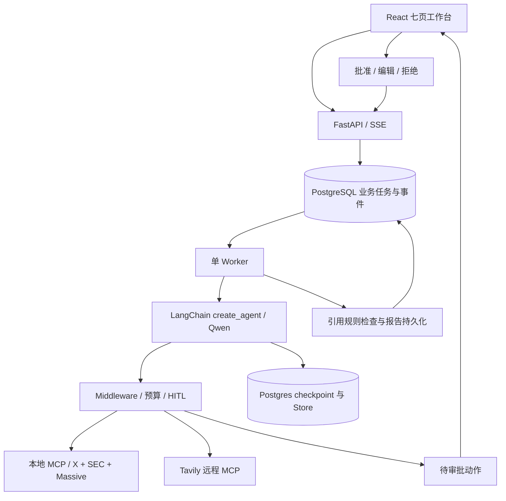
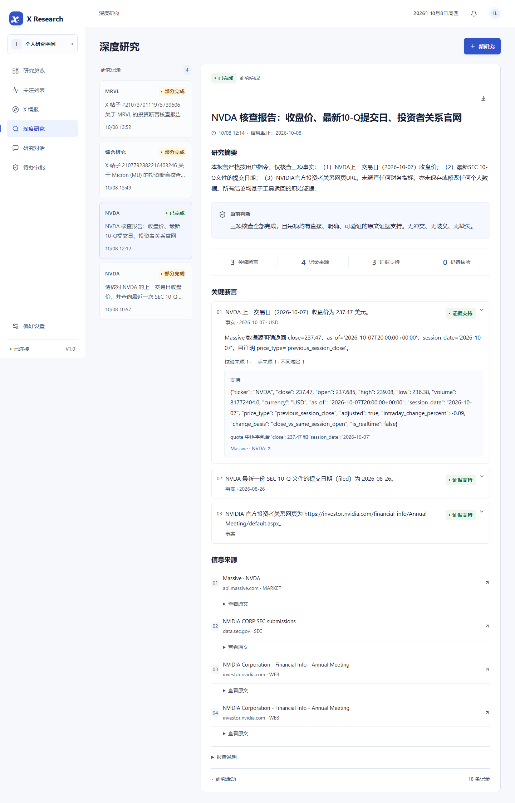

# X 投资观点研究助手 · AI Agent 工程案例

李林翼｜个人项目，使用 AI Coding 工具协作实现｜2026.08—至今

将用户选中的一条公开 X 投资观点转化为有来源、可复核的研究报告。工程重点是让取证、引用检查、运行恢复和人工审批成为可追溯的执行流程。

**线上工作台：[xresearch.86368360.xyz](https://xresearch.86368360.xyz/)**（需共享访问口令）。已完成 Ubuntu VPS、Nginx、Cloudflare Tunnel、PostgreSQL 与 systemd 部署，技术职责及公开访问检查见 [VPS 部署与上线实践](../deployment.md)。

## 核心流程与已实现能力

关注公开账号 → 同步混合帖子 → 用户选择具体观点 → 点击核查 → 获取外部资料 → 阅读断言与正反证据、来源和不确定性 → 继续研究。

账号时间线保留混合内容，不把生活帖自动当作投资观点；博主共识不构成事实证据。当前报告追问为静态文本，继续研究通过研究对话完成；一键携带报告上下文见产品目标设计。

| 工程能力 | 实际实现与代码 |
|---|---|
| Agent 与结构化报告 | [create_agent / ToolStrategy](../../backend/app/agent/factory.py)；研究模式只开放读工具，Chat 才可提议写入 |
| 有界工具集成 | [本地 FastMCP](../../backend/app/mcp_server.py) 封装 X、SEC、Massive REST；Tavily 使用远程 MCP search / extract |
| Runtime 与预算 | [RunContext](../../backend/app/agent/context.py) 注入 run_id；[Middleware](../../backend/app/agent/middleware.py) 限制调用、登记来源、处理错误；不是语义真伪分类器 |
| 持久化与恢复 | [Worker](../../backend/app/worker.py)、PostgreSQL 业务 Run / Event、LangGraph Postgres checkpoint / Store；浏览器断连不终止 Worker |
| 人工审批 | [审批决策](../../backend/app/approvals.py) 与 [写入边界](../../backend/app/agent/tools.py)；批准、编辑、拒绝与执行状态分开记录 |
| 证据质量控制 | [报告规则](../../backend/app/reports.py) 检查本次 source_id、引文定位、X 自证限制、冲突和预测；语义支持仍需复核 |
| 异常处理 | 取消、预算耗尽、部分来源不可用、审批失效、重启恢复；[X 分页水位](../../backend/app/x_sync.py) 不因部分错误跳过新帖 |

## 架构概览

## 验证结果

| 类型 | 实际记录 | 解释范围 |
|---|---|---|
| 历史真实调用，2026.10.08 | Qwen、Tavily、X、SEC、Massive 的受测能力可用；X 公开账号 5 帖入库 | 证明当时所测链路可用，不代表所有权限与套餐 |
| 历史真实研究，2026.10.08 | NVDA 研究：3 条断言、4 个来源、0 引文定位警告；4 次模型、4 次工具、4 次直接外部请求，32,657 tokens | 单个受限案例；不是事实准确率或投资收益指标 |
| 历史真实审批，2026.10.08 | 模型提议写入 → 重启 → 同一审批 → 拒绝 → not_executed | 没有自动批准真实个人资料写入；批准和编辑在隔离库测试 |
| 历史回归，2026.10.08 | 20 项后端测试、可读性修订后 6 项浏览器测试通过 | 后端包含隔离数据库；浏览器包含夹具和实际报告 |
| 历史无付费验证，2026.10.10 | 10 项后端测试通过、10 项数据库测试跳过；Ruff 检查和格式检查通过 | 当次未启动应用、未写业务数据库、未调用研究供应商 |
| 最新回归，2026.10.19 | 后端 40 项、浏览器 42 项通过；Ruff、格式检查和前端构建通过 | 独立测试库和浏览器夹具；未调用付费研究供应商，未修改个人业务记录 |
| VPS 上线，2026.10.19 | 作者完成服务器部署；公网首页、JS/CSS 返回 200，未登录 API 返回 401 | 上线技术实施按作者记录；只读公开检查不代替服务器内部和完整业务验收 |

完整口径和限制见 [验证与复现](03-验证与复现.md) 与 [历史验收记录](../validation.md)。前端构建与发布检查结果登记在 [上传质量检查](证据/上传质量检查.json)。

## 展示与阅读入口

1. [架构与职责](01-架构与职责.md)：组件选择、存储边界与数据源。
2. [运行、审批与异常](02-工作流与可靠性.md)：从单帖到报告、checkpoint 恢复、幂等与失败处理。
3. [验证与复现](03-验证与复现.md)：真实记录、当前安全检查与启动步骤。
4. [AI 产品案例](../ai-product-case/README.md)：需求、PRD、交互、评估、Figma 与可读性迭代。
5. [VPS 部署与上线实践](../deployment.md)：Ubuntu、SSH / Deploy Key、Nginx / SSE、Cloudflare Tunnel、systemd、数据库与 1GB RAM 资源配置。

该图是 2026.10.08 保存的真实验证界面，不是当前行情；完整历史报告和个人业务数据库不随仓库上传。

## 个人贡献与能力边界

本人负责问题提出、核心需求、使用流程、方案判断和自测反馈；代码与展示材料使用 AI Coding 工具协作完成，行情页由 AI 建议。项目没有外部用户访谈、机构合作或规模上线记录，不表述为独立手写全部代码。

当前是已部署到个人 VPS 的共享研究空间 MVP、单 Worker，使用共享口令访问。没有自动交易、图片理解、观点周报或外部推送；没有 RAG、向量库、上传文档处理或多 Agent 编排。站内定时简报与有限自动研究已有代码，不能等同观点周报或连续长期稳定性验证。本次线上以 systemd 管理宿主机进程；Docker 配置保留，未作容器启动验收。
