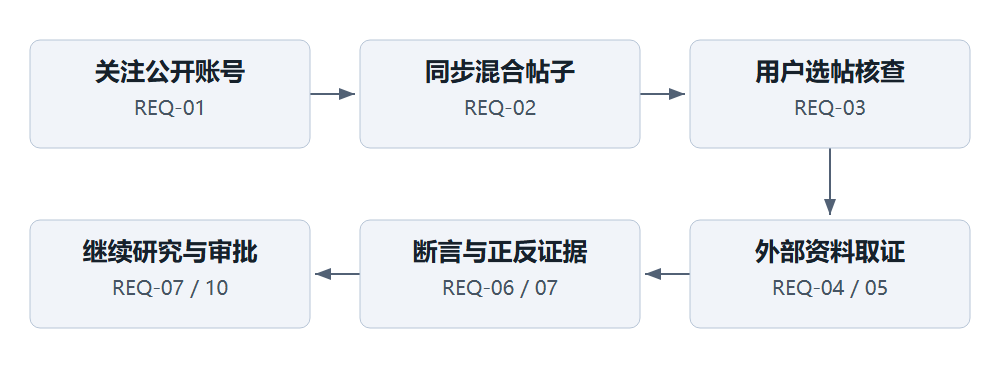
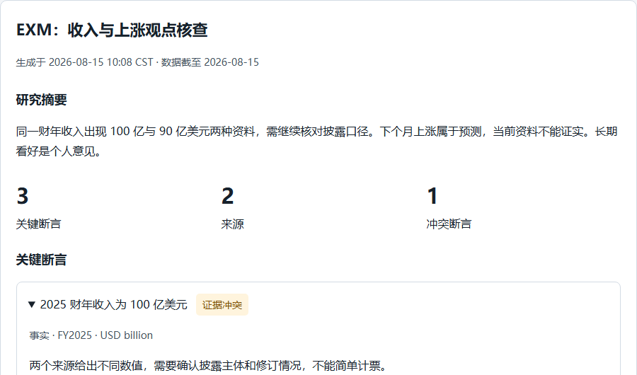

# 信息架构与交互设计

## 页面与任务结构

| 页面 | 名称与主要内容 | 关联需求 |
|---|---|---|
| P01 | 工作台：最近研究、状态、站内简报入口。 | REQ-08/11 |
| P02 | X 情报：关注账号、同步、混合帖子、核查入口。 | REQ-01/02/03 |
| P03 | 研究：任务历史、报告、断言、证据、来源、继续研究。 | REQ-03—08 |
| P04 | 关注标的：标的列表、行情口径、相关研究。 | REQ-05/09 |
| P05 | 对话：报告上下文、追问、运行与内嵌审批。 | REQ-07/08/10 |
| P06 | 审批：待决定、参数、期限、决定与执行结果。 | REQ-10 |
| P07 | 设置：连接状态、同步、简报、时区和额度。 | REQ-11 |

## 核心交互

账号添加成功后留在 X 情报，聚焦新账号并提供同步按钮。同步期间允许浏览已保存帖子；局部加载不阻塞全页。核查按钮只属于当前帖子，不做全账号自动授权；重复点击进入同一活跃任务。

报告采用摘要到证据的层级。断言类型和结论分开标识；点击证据定位来源片段。冲突需要并列两种方向及解释。来源详情可返回断言；不会因跳转原网页丢失报告阅读位置。继续研究以可移除上下文卡片说明本轮读了什么。

取消操作保持可见状态转换；网络连接状态与任务状态分开。审批页将决定与执行放在同一卡片连续显示，用户批准后先见“执行中”，收到持久结果后才显示“已执行”。

## 组件与状态规范

| 组件 | 必备状态 | 文案 / 行为 |
|---|---|---|
| 数据区 | 初次加载、空、已加载、局部错误、过期。 | 骨架仅用于等待；空态提供一个明确下一步；缺值使用破折号和原因。 |
| 提交按钮 | 可用、校验失败、提交中、已受理。 | 提交中阻止重复；错误保留输入；成功进入持久任务。 |
| 断言卡片 | 类型、状态、折叠 / 展开、证据不足、冲突。 | 不用绿色表示预测为真；文字标签可独立识别。 |
| 来源卡片 | 定位成功、原网页失效、引文无效、撤回。 | 无效证据不纳入支持计数；撤回隐藏正文。 |
| 审批卡片 | 待决定、编辑中、已决定、执行中、执行失败、超期。 | 参数不可省略；期限带时区；不提供默认自动批准。 |

## 视觉与响应式

深色正文 #17212B，次级文字 #465463，白色卡片与浅灰背景；主色用于操作，不承担全部状态编码。正文行高 1.6—1.75；单列阅读宽度限制在约 70—85 个中文字符以内。表格在小屏使用受控横向区域，主要内容不横溢。

桌面左侧导航和任务历史辅助定位；手机导航折行并保留文字，报告单列，按钮不挤压正文。焦点、hover、disabled 与错误态明确；状态更新使用 role=status，错误使用就地文字。图表必须有文字说明和替代描述。

七页桌面与手机设计见[页面设计手册](../页面设计手册.html)，可与交互原型中的 P01—P07 对照阅读。

## 原型演示路径

打开离线原型后：添加示例账号 → 同步 → 跳过生活帖子 → 核查投资观点 → 查看断言与来源 → 点击继续研究 → 提议加入关注列表 → 编辑或拒绝审批。另用状态选择器体验部分完成、失败、取消、等待审批、过期与空状态。

原型的任务、审批与设置操作均是浏览器内的状态转换。刷新或重置后恢复初始示例；持久化恢复的产品规范由 PRD 与验收定义，而不是把内存原型当作后端实现证明。
