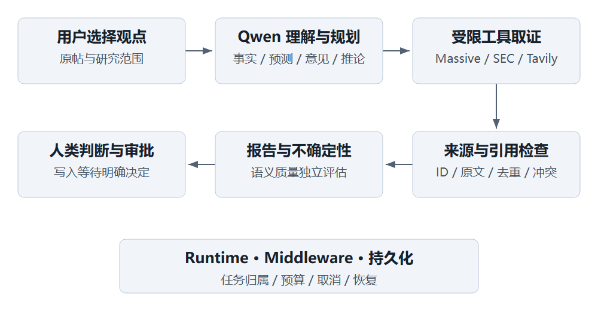

# AI 工作流与质量控制

## AI 的工作与确定性边界

Qwen 负责理解观点、拆分断言、选择受限工具、解释证据关系与组织结构化报告。应用代码负责权限、状态、预算、来源收录、引文定位、状态收束与审批执行。研究结论的语义仍需通过评价和人工阅读核对，不能以中间件存在就宣称自动保证事实正确。

## 技术职责与产品收益

| 能力 | 项目职责 | 对用户的意义 |
|---|---|---|
| LangChain create_agent | 管理模型与工具循环，研究模式结构化输出。 | 同一报告具有可展示字段；不是额外业务功能。 |
| Runtime / RunContext | 注入当前 user_id、run_id 等上下文及存储访问。 | 来源、预算与写操作归属当前任务；不让模型自造身份。 |
| Middleware | 事件记录、预算与取消检查、模型 / 工具次数限制、工具错误与有限重试、HITL。 | 失败可见、成本有界、写操作受控。 |
| MCP | 将有限 X、SEC、Massive 适配器与 Tavily 搜索 / 抽取提供为工具。 | 工具输入输出可约束；协议本身不鉴定资料真假。 |
| PostgreSQL 业务表 | 保存帖子、Run、来源、断言、审批及结果。 | 刷新后可继续阅读与核查。 |
| Checkpointer / Store | 前者保存 Agent 执行状态与 interrupt；后者保存长期偏好和观点。 | 同 thread_id 恢复原审批；长期信息不混同本轮上下文。 |

Runtime 与 Middleware 概念参考 [LangChain Runtime](https://docs.langchain.com/oss/python/langchain/runtime)和[Middleware](https://docs.langchain.com/oss/python/langchain/middleware/overview)。暂停恢复机制参考 [LangGraph Interrupts](https://docs.langchain.com/oss/python/langgraph/interrupts)。本项目具体能力由代码与锁定依赖决定，不使用最新版文档推定现有功能。

## 质量控制分层

输入层：保留原帖与截至时间；外部文本标记为不可信资料；不执行网页或帖子中的系统命令。规划层：区分事实、预测、意见和推论，按财务、价格、新闻路由工具；避免为了凑来源反复调用。

证据层：保存 source_id、excerpt、URL、时间与 hash；检查引文定位并移除无效引用；X 不为自身主张核实。解释层：逐项核对主体、指标、单位、时期、比较基准和条件；冲突必须解释，不合口径不能直接比较。呈现层：摘要与断言一致，保留不确定性和缺失信息；不输出未经校准的“可信度 90%”。

评估层：程序规则用可重复夹具测试；语义用带标准答案与理由的用例逐项评分；端到端验证关注任务和控制行为。把“引用能找到”“语义真的支持”“使用者正确理解”分别测量。

## 人机协作与边界

用户选择核查对象、阅读证据与作出最终判断。Agent 可以建议加入关注列表、保存投资观点、调整偏好或来源信任，但须明确展示待写参数并等待人工决定。批准是授权步骤，执行成功是另一个可验证步骤。程序不替用户同意。

图片关键内容未读取时，报告应提示范围并保持证据不足；未来价格预测只评价依据和条件。无资料时可以交付“未取得足够证据”的部分结果，不能把流畅叙述当成功。活动面板只展示阶段、工具和预算，不展示隐藏推理过程。

## 成本与可靠性选择

采用单 Agent、少量工具与固定预算，优先让单帖任务可测、可恢复。无上传知识库任务时不增加 RAG 与向量库；没有多模态解析链时不加入 OSS 或 MinerU。外部只读请求可能因进程崩溃重复，记录请求计数和幂等边界；预算是控制机制，不构成供应商费用保证。
