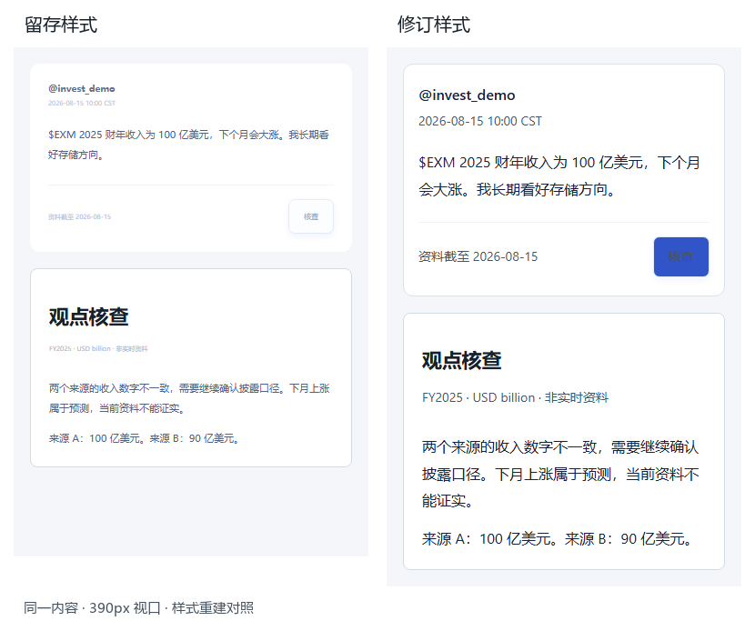

# 可读性迭代案例

## 问题与触发场景

本人在浏览帖子、报告和设置时反馈：标题之外大量浅色小字难以阅读，冗余解释影响真实应用使用。核查产品需要反复比较数字、来源和条件；如果正文难读，即使取证成功，也难以形成可靠判断。迭代对象因此是整站信息层级，而非单独美化首页。

## 证据与设计目标

留存原样式在帖子、报告、辅助字段和移动断点中存在 7—12px 字号及浅色文字。修订后样式、七页截图与浏览器检查保留在仓库。没有可靠原始“修改前页面截图”时，不将现有修改后截图重新标成修改前；样式对照图用同一内容分别加载留存与修订样式，以展示变化本身。

目标是正文 16px、辅助至少 14px、正常文本对比度 ≥4.5:1，1440px 与 390px 无非预期横向溢出；删去无决策价值的重复说明，保留来源、日期、单位、审批期限和关键警告。

## 方案取舍与执行

| 问题 | 选择 | 保留的决策信息 |
|---|---|---|
| 字体依赖屏宽缩小 | 统一正文与辅助字号，手机不再次缩小。 | 帖子、行情日期、引文与审批参数。 |
| 次级文字过浅 | 统一深色次级文字与输入占位色。 | 更新时间与字段说明仍有层级。 |
| 首屏解释占用空间 | 删除宣传区、重复副标题与装饰标签。 | 空状态、异常与风险说明仍在需要时出现。 |
| 报告信息堆叠 | 第一条断言展开，说明和活动折叠。 | 支持与反对证据保持同层可达。 |
| 手机操作拥挤 | 调整导航、表单、按钮和时区布局。 | 操作标签不省略为难懂图标。 |

放弃“把一切次级信息隐藏”方案，因为时间、单位和来源是研究判断的一部分；放弃只改颜色，因为过小字号和冗余文案仍妨碍使用。

## 修改前后与验收

| 维度 | 留存样式可验证情况 | 修订后可验证变化 |
|---|---|---|
| 正文与辅助字号 | 部分 7—12px，移动端继续缩小。 | 正文 16px，辅助 ≥14px。 |
| 文案 | 宣传与常驻解释重复。 | 删除重复说明，保留决策字段。 |
| 报告层级 | 多种低频信息同屏竞争。 | 说明与运行活动折叠。 |
| 验收范围 | 原样式本身，不推断用户错误比例。 | 构建通过；最终共 6 项浏览器测试；七页、两宽度与关键弹窗。 |

自动检查覆盖渲染文字与输入占位文字的字号、对比度和横向溢出，并结合截图查看。没有真实任务耗时、满意度或外部样本，不宣称效率提升百分比；也不把局部对比度检查等同完整 WCAG 合规。

## 产品启示与下一次验证

AI 产品价值不仅取决于模型生成，还取决于用户能否读懂证据及边界。低频过程可以折叠，影响决策的时间、单位、反例不能删。下一次验证采用两项理解任务：准确说出行情交易日；从一个冲突断言找到两方引文。比较理解错误类型，而非仅收集“界面更好看”的评价。
