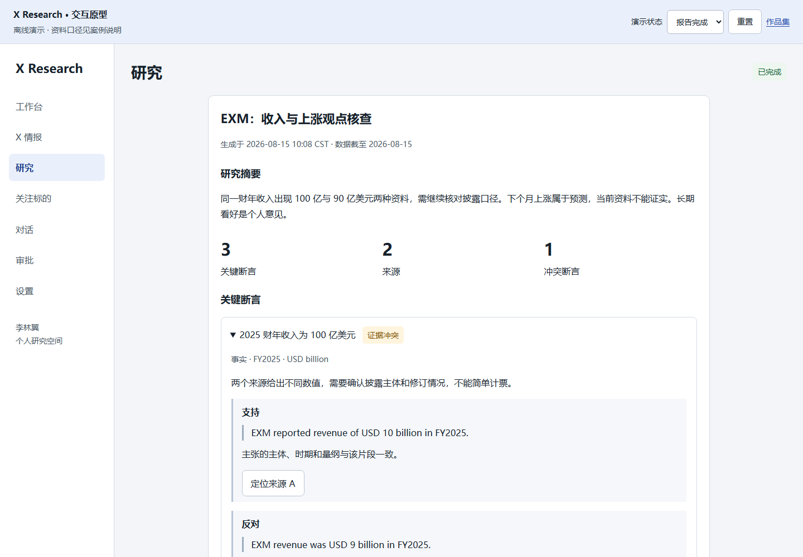

# X 投资观点研究助手

AI 产品实习项目案例｜李林翼｜2026.08—至今

把一条公开投资观点，变成可追溯、可追问的研究判断。

看到 MU 或存储板块的上涨观点后，我需要逐一核对价格、披露与新闻。产品把这个任务组织成：关注账号 → 同步混合帖子 → 选择一条观点 → 核查 → 阅读断言与正反证据 → 继续研究。

## 项目概览

| 目标用户 | 阅读公开 X 美股观点、愿意核对资料的个人研究者。 |
|---|---|
| 核心问题 | 原帖、事实、预测和外部资料分散，来源与时间口径难对应。 |
| 产品形态 | React + Python FastAPI + PostgreSQL 的本地研究工作台。 |
| 个人职责 | 问题定义、核心需求与流程判断、验证反馈、产品材料；AI Coding 协作实现。 |
| 交付 | PRD、研究与竞品、交互原型、AI 评估、验收、可读性迭代与技术证据。 |

资料属性统一见《案例资料说明》。本册的简历成绩只采用真实项目记录。

<!-- PAGE -->

## 从场景到需求

用户关注的人不会只发投资内容，所以先同步混合帖子，再由用户选择具体观点。任务成功不是“给一个看多结论”，而是能解释哪个断言由什么支持、哪些证据相冲突、哪些问题不能确认。

| 观察 / 问题 | 产品判断 | 需求 |
|---|---|---|
| 混合帖子需要用户筛选 | 保留选择权，按单帖触发成本。 | REQ-01—03 |
| 一句话混合事实和预测 | 原子拆分与类型区分。 | REQ-04 |
| 数字、时期、出处容易错配 | 引文、方向、时期单位同时呈现。 | REQ-05/06 |
| 看完报告仍要深挖 | 报告上下文延续，写入单独审批。 | REQ-07/10 |

竞品研究借鉴 AlphaSense 的引用定位与追问；社区情绪表达倾向，不能替代事实核查。需求优先级按闭环必要性和错误后果决定，先做单帖与证据控制，再扩展图片、周报和外部推送。

研究材料采用任务画像、用户旅程和四条 SIM-R 演示访谈，完整展示方法；真实使用验证目前来自本人。

<!-- PAGE -->

## 关键体验与交互

摘要先帮助用户了解覆盖范围；断言卡片区分事实、预测、意见与推论；支持和反对证据同层可见；来源可定位保存片段。继续研究保留明确上下文，审批展示参数与期限。

原型可体验添加账号、同步混合帖子、单帖核查、来源定位、追问及编辑 / 拒绝审批，也包含部分完成、失败、取消和过期状态。所有内容离线合成，不发真实请求。

<!-- PAGE -->

## AI 产品判断与评估

| 环节 | 负责什么 |
|---|---|
| Qwen | 理解、拆分、选择受限工具和组织结果。 |
| Massive / SEC / Tavily | 行情 / 公司披露 / Web 取证；X 是观点入口。 |
| Runtime / Middleware | 归属上下文、预算、取消、日志、有限重试与审批。 |
| 持久化 | 保存任务结果、来源与审批；原 thread_id 恢复中断。 |

关键判断：引文能找到不等于语义支持；预测不能被资料证明为未来事实；批准不等于写入成功。权限、预算与来源定位用代码控制，语义用独立评价核对，不加入无需求的 RAG 或多 Agent。

真实记录：一次 NVDA 研究交付 3 条断言、4 个来源、0 引文定位警告；真实审批重启后拒绝成功，个人写入未执行。现有记录有 20 项后端单元及集成测试、最终 6 项浏览器测试。本轮纯函数 10/10 规则场景与 9 项证据单元测试通过；这些结果不等于金融正确率。

语义评估另用八条 SIM-E 人工输出展示时期、单位、反证与失败的评分及阻断决策，不作为模型实测成绩。

<!-- PAGE -->

## 迭代案例：让证据读得清

触发：本人反馈全站浅色小字难读、说明冗余。证据：留存样式、修订后截图与浏览器验收。目标：先保证阅读，再优化信息密度。

| 取舍 | 可验证变化 |
|---|---|
| 统一字号，手机不再缩小 | 正文 16px，辅助 ≥14px。 |
| 深色文字，删除重复说明 | 保留来源、时间、单位、期限与关键警告。 |
| 渐进披露 | 低频说明与运行活动折叠，反对证据仍可达。 |
| 验收 | 七页、1440px / 390px、关键弹窗；字号、4.5:1 对比度和溢出检查。 |

不编造效率或满意度提升。产品启示是：AI 的输出只有被正确阅读和复核，才完成用户任务。

<!-- PAGE -->

## 成果、贡献与展示路径

我把单帖核查任务转化为可实现的需求、页面和质量控制，使用 AI Coding 协作完成本地 MVP，并用真实调用、审批恢复与可读性验收证明交付。页面核心需求由本人提出，行情页由 AI 建议。

## 可用于简历

- 围绕公开 X 投资观点的跨来源核查，设计账号追踪、混合帖子选取、单帖研究、断言证据报告与审批流程，使用 AI Coding 工具协作完成本地 MVP。
- 集成 Qwen、Tavily、X、SEC 与 Massive；真实研究交付 3 条断言与 4 个来源、0 引文定位警告，验证审批跨重启拒绝恢复。
- 推进七页可读性修订，统一正文与辅助字号并保留决策字段；项目记录 20 项后端测试及最终 6 项浏览器测试通过。

## 深入阅读

先体验离线原型，再阅读完整产品交付文档中的 PRD、评估与迭代；技术附录集中提供目标方案与当前代码的对应关系。下一步优先完善任务去重、上下文追问与简报一致性，再按明确门槛扩展图片和周报。

官方依据与资料属性见完整文档统一说明和来源登记；原稿、评估表和真实执行记录均随本地材料交付。
