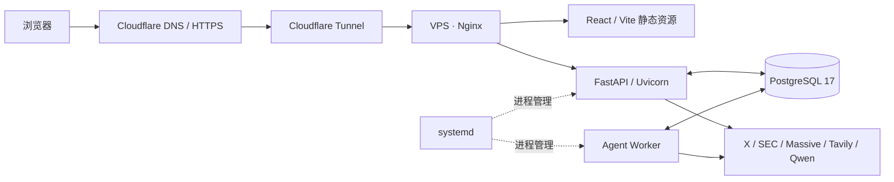

# VPS 部署与上线实践

线上入口：**[X Research](https://xresearch.86368360.xyz/)**，使用共享访问口令进入研究工作台。

2026-10-19，项目作者完成 Ubuntu 24.04 LTS VPS 上线，并提供了以下部署实施信息。本次文档更新另外通过公开 HTTPS 请求检查了首页、静态资源及未登录 API；没有通过 SSH 登录服务器或修改线上数据。

## 实际部署形态

本次使用 VPS 宿主机安装服务，以 systemd 管理 FastAPI 和 Agent Worker。Nginx 托管 React 生产构建产物并转发 API，Cloudflare DNS、Tunnel 与 HTTPS 提供自定义域名访问。仓库中的 Dockerfile / Compose 保留为另一种部署方案，未作为本次上线方式或容器验收结果。

应用仍采用共享研究空间、共享访问口令和单 Worker。多个访问者进入同一份研究、对话、关注与偏好数据；本次上线没有增加独立用户账号或多租户隔离。

## 技术在项目中的实际应用

下表记录作者本次部署中实际完成的工作。公开 HTTP 检查的范围单列在后文；操作系统、服务单元及资源参数以作者提供的部署记录为依据。

| 技术 | 在本项目中的实际应用 |
|---|---|
| Linux / Ubuntu | 使用 Ubuntu 24.04 LTS VPS，完成软件安装、目录与文件管理、运行权限配置和系统管理。 |
| SSH / SCP | 配置 SSH 密钥认证，远程管理服务器，并安全传输项目文件和前端构建产物。 |
| Git / GitHub | 在 VPS 克隆私有仓库，配置 Deploy Key，用于获取代码和管理部署版本。 |
| Nginx | 托管 React 静态资源，反向代理 FastAPI，并配置 SSE 流式响应的转发。 |
| Cloudflare | 配置 DNS、Cloudflare Tunnel 和 HTTPS，将服务绑定到自定义域名。 |
| FastAPI / Uvicorn | 在 Linux 服务器上运行 Python API 服务，承接研究、对话、审批、配置与事件流请求。 |
| PostgreSQL 17 / Alembic | 创建数据库与用户，通过 Alembic 迁移初始化业务表结构，并调整数据库内存和连接参数。 |
| systemd | 将 FastAPI 与 Agent Worker 配置为后台服务，管理启动、停止、开机自启和进程状态。 |
| Python uv / venv | 使用锁定依赖管理 Python 环境，创建隔离运行环境并安装项目依赖。 |
| React / Vite | 完成生产构建，将生成的 HTML、CSS 和 JavaScript 静态资源部署到 Nginx。 |
| 资源优化 | 面向 1GB RAM VPS，调整数据库连接池、PostgreSQL 内存与连接配置，以及 Worker 内存限制和服务资源使用。 |
| 基础安全配置 | 使用专用 Linux 用户、SSH 密钥、文件权限、应用访问 Token 和本地端口隔离，分离公网入口与内部服务。 |

## 服务职责与配置要点

### 静态页面、API 与 SSE

Nginx 负责前端静态文件及 API 反向代理。SSE 用于持续向浏览器传递研究活动与回答文本，代理需保留流式传输，避免把事件积累到完整响应后才交给浏览器。Nginx 官方说明 `proxy_buffering off` 会随收到的上游响应同步转发；超时和缓存规则需与实际事件流配合。[Nginx 代理文档](https://nginx.org/en/docs/http/ngx_http_proxy_module.html#proxy_buffering)

Vite 的生产构建输出用于静态托管；开发服务器和 `vite preview` 不作为这次线上前端服务。[Vite 部署说明](https://vite.dev/guide/static-deploy.html)

### 后台进程与持久化

API 与 Worker 使用不同的 systemd 服务单元。API 接收请求并读取 / 写入任务状态；Worker 执行研究和调度任务，通过 PostgreSQL 保存业务记录、事件及 Agent 持久化上下文。项目命令入口见 [CLI](../backend/app/cli.py)，迁移见 [backend/migrations](../backend/migrations)。

systemd 负责服务的生命周期与资源控制；运行用户、工作目录、环境文件位置及资源限制由服务器单元配置决定。[服务单元文档](https://www.freedesktop.org/software/systemd/man/latest/systemd.service.html)、[资源控制文档](https://www.freedesktop.org/software/systemd/man/latest/systemd.resource-control.html)

### 1GB RAM 下的资源配置

本次进行了数据库连接与内存、应用连接池和 Worker 内存限制的调整。连接池大小、数据库连接上限、PostgreSQL 内存参数和 systemd 内存限制需要合并考虑，避免多个进程各自的连接与内存预算超过 VPS 容量。

具体线上配置值和调整前后的资源测量尚未随文档提交，因此这里不填写推测的 `pool_size`、`max_connections`、`shared_buffers` 或 `MemoryMax` 数值，也不声明吞吐量、性能提升比例或长期无 OOM。仓库中 [db.py](../backend/app/db.py) 的默认值不能直接当成线上最终值。[PostgreSQL 17 资源配置](https://www.postgresql.org/docs/17/runtime-config-resource.html)

### 访问控制与凭据

`APP_AUTH_TOKEN` 是网站共享访问口令；供应商 API Key 由服务器后端使用；GitHub Deploy Key 用于服务器获取代码；SSH 密钥用于远程管理主机。这些凭据分别配置，不在文档中公开具体值。[GitHub Deploy Key 说明](https://docs.github.com/en/authentication/connecting-to-github-with-ssh/managing-deploy-keys)

环境文件只保存在部署环境，字段包括 `DATABASE_URL`、`APP_AUTH_TOKEN`、Qwen / Tavily / X / Massive 配置和 `SEC_USER_AGENT`。仓库中的 [.env.example](../.env.example) 提供变量说明；不提交真实 `.env`、数据库文件、SSH 私钥、Deploy Key、Cloudflare Tunnel 凭据或原始服务日志。

## 公开访问核对

2026-10-19 07:34 UTC（北京时间 15:34）执行只读检查，未发送访问口令，也未发起研究、同步、审批或删除请求。

| 检查项 | 观察到的结果 |
|---|---|
| `https://xresearch.86368360.xyz/` | HTTPS 请求成功，返回 200 和 HTML。 |
| 首页引用的 JavaScript | `/assets/index-C_FCmvoV.js` 返回 200，类型为 JavaScript。 |
| 首页引用的样式表 | `/assets/index-BoBpNc74.css` 返回 200，类型为 CSS。 |
| Cloudflare 响应标识 | 响应存在 `CF-Ray` 头，表明本次公开请求经过 Cloudflare。 |
| 未登录的 `/api/v1/health` | 返回 401 和 JSON，符合受保护 API 的访问行为。 |

脱敏机器可读摘要：[VPS 公网访问检查](agent-case/证据/VPS公网访问检查.json)。静态资源文件名对应本次检查时的构建，后续更新会变化。

上述结果证明检查时公开页面与静态资源可访问，以及所测 API 未允许匿名访问。服务器操作系统、Tunnel 配置、systemd 自启和资源调整由作者确认；本次公开探测不替代登录后的完整研究、SSE 时序、系统重启、高并发或长期稳定性验收。

## 运行维护与版本记录

- 通过 Git 记录源码版本，使用 Deploy Key 获取私有仓库。部署侧配置和构建产物也需与该版本对应，避免源码、前端资源与环境配置错配。
- 使用 `systemctl` 查看 API / Worker 服务状态，通过 `journalctl` 查看对应服务日志。实际服务单元名、安装目录与配置值以服务器为准，本仓库未导出这些线上文件。
- 更新前保留数据库和必要配置的备份，审阅 Alembic 迁移；数据库备份与恢复演练尚无本次实测记录，不能将维护建议写成已完成成果。
- 文档更新没有连接服务器或重启线上服务，应用功能、权限及 API 用量配置保持现状。

其他官方参照：[Ubuntu OpenSSH](https://ubuntu.com/server/docs/openssh-server/)、[FastAPI 手动运行](https://fastapi.tiangolo.com/deployment/manually/)、[uv 锁定与环境同步](https://docs.astral.sh/uv/concepts/projects/sync/)、[Cloudflare Tunnel](https://developers.cloudflare.com/cloudflare-one/networks/connectors/cloudflare-tunnel/)。
