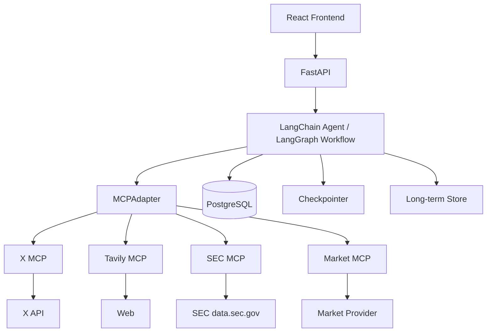
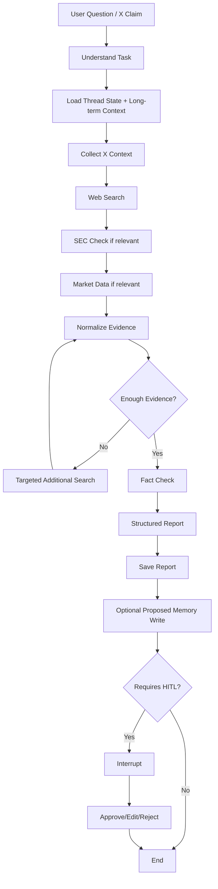
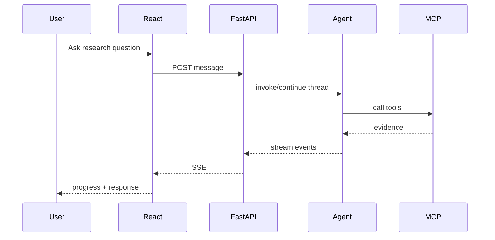
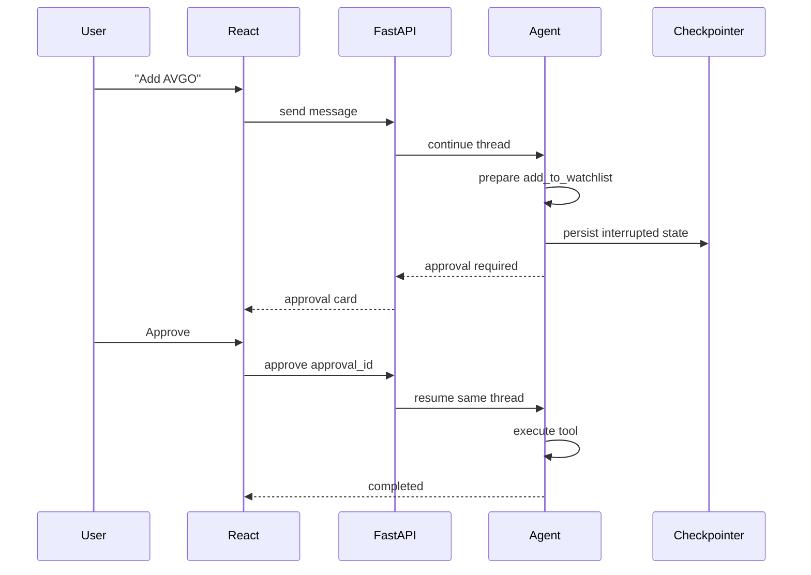

# X Investment Research Agent — 第一版项目需求与技术规格

> 文档用途：本文件用于直接交给 AI Coding Agent / 开发 Agent，作为第一版项目的完整实现依据。  
> 项目定位：个人使用的 AI 投资研究平台，以 X（Twitter）投资观点为起点，通过 Web、SEC、市场数据等多源证据进行事实核查和综合研究。  
> 第一版范围：完成原计划 Phase 1–5。  
> 明确排除：Phase 6 RAG 及之后的 Multi-Agent / Subagent 等高级能力，统一列入“未来升级”，不得提前加入第一版复杂度。

---

## 0. 开发 Agent 必读

请严格遵循以下原则：

1. **这是传统前后端 Web 项目，不使用 Streamlit。**
2. 前端使用 **React + TypeScript + Vite**。
3. 后端使用 **Python + FastAPI**。
4. Agent 使用 **LangChain + LangGraph**。
5. MCP 优先采用当前 LangChain 官方推荐的 `langchain.mcp.MCPAdapter` 路线；实现前检查当前安装版本和官方 API，避免继续使用已迁移/过时的旧 MCP 示例。
6. 第一版必须真实接入：
   - X API
   - Tavily MCP
   - SEC EDGAR 数据
   - Market Data Provider
7. **不得在正常运行路径中使用假数据伪装真实 API 结果。**
8. API Key 缺失、额度不足或外部服务不可用时，应在 UI 中明确显示“未配置 / 暂不可用”，而不是生成虚构数据。
9. 所有密钥只保存在后端环境变量中，绝不能暴露到前端 bundle。
10. 第一版不做 RAG、Embedding、Vector Store、Multi-Agent、自动交易。
11. Human-in-the-loop（HITL）必须支持：
    - Research Chat 内联审批
    - 独立 Approvals 页面查看后台/未完成审批
12. Agent 的事实性结论必须有 Evidence；X 内容默认视为“观点/线索”，不能默认视为事实。
13. 第一版目标是**功能完整、架构清晰、可扩展**，而不是追求所有高级 Agent 技术同时存在。

---

# 1. 产品定义

## 1.1 产品名称

**X Investment Research Agent**

副标题可使用：

> AI-powered investment research from social signals to verified evidence.

中文定位：

> **从 X 投资观点出发，通过多源事实核查生成结构化投资研究的个人 AI 平台。**

---

## 1.2 核心问题

普通社交媒体投资分析存在三个问题：

1. 只看到博主的一两句话，信息不完整；
2. 用户容易把“观点”误认为“事实”；
3. 即使观点合理，也缺少 SEC、公司公告、新闻和市场数据等独立证据支持。

本系统不直接把 X 帖子总结成投资建议，而是把 X 当成：

> **Signal / Claim Source（信号和观点来源）**

然后由 Agent 主动查找：

- 官方 SEC filings；
- 公司公开资料；
- Tavily Web Search 获取的高质量新闻/网页；
- 市场价格和基础行情；
- 其他 X 观点；

最后输出：

- 观点是什么；
- 哪些内容属于可验证 Claim；
- 有什么支持证据；
- 有什么反驳证据；
- 证据是否充分；
- 多空因素；
- 风险；
- 置信度；
- 来源列表。

---

# 2. 第一版目标

第一版完成后，用户应该能够：

1. 配置并关注指定 X 博主；
2. 自动或手动同步这些账号的新帖子；
3. 查看与投资相关的 X 内容；
4. 让 Agent 从帖子中提取投资 Claim；
5. 让 Agent 使用 Tavily / SEC / Market MCP 进行研究；
6. 对 Claim 做事实核查；
7. 生成结构化投资研究报告；
8. 在 Research Chat 中自由提问；
9. 在 Chat 中对敏感写操作进行 HITL 审批；
10. 在 Approvals 页面查看后台产生或尚未处理的审批；
11. 使用 Checkpointer 恢复被 HITL 暂停的 Agent；
12. 使用 Store 保存经批准的跨 Thread 长期研究上下文；
13. 定时生成 Daily Research / Daily Brief；
14. 在 Dashboard 查看当天重要投资信号。

---

# 3. 第一版明确不做

以下内容全部属于 Future Upgrade，不属于第一版验收范围：

- RAG；
- Embedding；
- Vector Database；
- 财报全文向量检索；
- Multi-Agent；
- Supervisor Agent；
- Subagent；
- Agentic RAG；
- 自动下单；
- Broker API；
- 真实证券交易；
- 自动在 X 发帖；
- 自动对外发布研究内容；
- Mobile App；
- 多租户 SaaS；
- 复杂 RBAC；
- 社区功能。

如果开发 Agent 判断某个第一版功能“以后用 RAG 会更好”，应保留扩展接口，但**不要现在实现 RAG**。

---

# 4. 为什么前端选择 React

第一版前端固定：

- React
- TypeScript
- Vite

推荐辅助库：

- React Router
- TanStack Query
- Zustand（只存少量跨页面 UI 状态）
- Tailwind CSS 或 CSS Modules（二者任选其一，但必须支持自定义设计系统）
- Radix UI primitives 可用于 Dialog、Popover、Tooltip 等无障碍基础组件
- Lucide Icons

选择 React 的原因：

1. Dashboard / Chat / Approval / Streaming 生态成熟；
2. AI Coding Agent 对 React 项目支持通常更稳定；
3. 后续可较容易迁移到 Next.js；
4. 状态管理、SSE、图表和组件生态更丰富；
5. 本项目 UI 不是单纯表单，而是多种异步状态和实时研究过程，React 更合适。

不得使用 Streamlit 作为主前端。

---

# 5. UI / Design System

## 5.1 设计目标

视觉风格：

- 白色主色；
- Royal Blue 作为唯一主要品牌点缀色；
- 类似 iOS / Apple 系产品的简洁感；
- 专业、克制、金融研究感；
- 少量 Liquid Glass；
- 优先可读性，不追求炫技。

整体关键词：

> Clean / Calm / Professional / iOS-like / Research-focused / High readability

---

## 5.2 颜色

主色：

```css
--color-primary: #4169E1; /* Royal Blue */
```

建议基础颜色：

```css
--bg-main: #FFFFFF;
--bg-secondary: #F7F8FB;
--surface: #FFFFFF;
--surface-muted: #F3F5F9;

--text-primary: #111318;
--text-secondary: #5E6470;
--text-tertiary: #8A9099;

--border: #E5E8EF;
--border-strong: #D6DAE3;

--primary: #4169E1;
--primary-hover: #3557C8;
--primary-soft: #EEF2FF;

--success: #15803D;
--warning: #B7791F;
--danger: #C53B3B;
```

不要使用大量高饱和颜色。

Bullish / Bearish 可以使用柔和绿红，但必须保持低饱和、可读。

---

## 5.3 Liquid Glass 使用规则

Liquid Glass 只能少量使用在：

- 顶部导航；
- Sticky Chat Composer；
- Modal / Dialog；
- Approval 浮层；
- 轻量 Floating Control。

示例：

```css
background: rgba(255, 255, 255, 0.76);
backdrop-filter: blur(18px) saturate(140%);
-webkit-backdrop-filter: blur(18px) saturate(140%);
border: 1px solid rgba(255, 255, 255, 0.72);
box-shadow: 0 8px 30px rgba(17, 24, 39, 0.08);
```

要求：

1. 文字所在区域必须有足够不透明度；
2. 不允许整个 Dashboard 所有 Card 都做 Glass；
3. 不允许透明导致背景文字干扰阅读；
4. 浏览器不支持 `backdrop-filter` 时必须有纯色 fallback；
5. Data Table / Research Report 以纯白 Surface 为主。

---

## 5.4 圆角与阴影

推荐：

```text
Small control:   10–12px
Card:            16px
Large panel:     18–20px
Modal:           20px
```

阴影克制：

```css
box-shadow: 0 4px 18px rgba(17, 24, 39, 0.06);
```

不要使用厚重 Material 风格阴影。

---

## 5.5 字体

优先系统字体：

```css
font-family:
  Inter,
  -apple-system,
  BlinkMacSystemFont,
  "SF Pro Display",
  "SF Pro Text",
  "Segoe UI",
  sans-serif;
```

正文以可读性优先。

---

## 5.6 动效

- 交互动画 160–220ms；
- 使用 ease-out；
- Hover 轻微；
- 不做夸张缩放；
- Research Progress 可以使用柔和 loading indicator；
- Respect `prefers-reduced-motion`。

---

# 6. 页面信息架构

第一版 Sidebar：

```text
X Investment Research

Dashboard
Watchlist
X Intelligence
Research
Research Chat

----------------

Approvals (n)
Settings
```

桌面端优先。

移动端第一版只需做到基本响应式，不要求完整 Mobile App 体验。

---

# 7. 页面一：Dashboard

目标：

> 用户打开平台后，在 30 秒内知道今天 AI / 科技投资相关发生了什么。

页面结构：

```text
┌──────────────────────────────────────────────┐
│ Dashboard                         Oct 7      │
├──────────────────────────────────────────────┤
│ Watchlist Market Snapshot                    │
│ NVDA   AMD   MSFT   META   GOOGL ...         │
├──────────────────────────────────────────────┤
│ Today's Investment Brief                     │
│                                              │
│ 1. NVDA — AI CapEx discussion intensified   │
│ 2. AMD  — New product / demand signals      │
│ 3. MSFT — Infrastructure spending update    │
├──────────────────────────────────────────────┤
│ X Signals                                    │
│ @A → NVDA Bullish                            │
│ @B → AMD Bearish                             │
├──────────────────────────────────────────────┤
│ Recent Research                              │
│ NVDA outlook                                 │
│ AI CapEx verification                        │
└──────────────────────────────────────────────┘
```

功能：

- Watchlist 当前/最近价格；
- 今日 X 重点信号；
- 今日已验证 Claim；
- 最近 Research Runs；
- Pending Approvals 数量；
- Daily Brief。

第一版图表保持简单，不追求 Bloomberg Terminal 密度。

---

# 8. 页面二：Watchlist

功能：

- 添加股票；
- 删除股票（HITL 只在 Agent 自动调用时触发；用户直接点击 UI 删除可用普通确认 Dialog）；
- 查看股票详情；
- 触发 Research。

股票详情：

```text
NVDA

Market Snapshot
- price
- change %
- volume
- market cap（如 provider 支持）

Current Research Thesis
- Bullish Factors
- Bearish Factors
- Key Risks

Recent X Signals
Recent Claims
Recent Evidence
Recent Research Reports

[Start Research]
[Ask in Chat]
```

注意：

用户主动在 UI 按“Add / Delete Watchlist”不需要绕 Agent。

只有当 Agent 自主调用修改状态 Tool 时，才走 HITL。

---

# 9. 页面三：X Intelligence

## 9.1 功能

展示关注账号：

- username；
- display name；
- 分类；
- 最近同步；
- 最近帖子；
- Investment relevance；
- 相关 ticker；
- 是否已提取 Claim；
- Fact-check status。

---

## 9.2 X Post Card

示例：

```text
@analyst_A                      2h

Hyperscalers are cutting AI capex.
NVIDIA growth is about to collapse.

Related:
NVDA / MSFT / META

Claims detected: 2

1. Hyperscalers are cutting AI CapEx.
   Status: Contradicted

2. NVIDIA growth is about to collapse.
   Status: Insufficient evidence

[View Evidence]
[Start Research]
```

---

## 9.3 Influencer / Source Profile

显示：

- 常讨论行业；
- 常讨论 ticker；
- 历史 Claim 数；
- Verified / Contradicted / Inconclusive 分布；
- Reliability Score；
- 最近观点变化。

Reliability Score 必须来自系统规则/历史 Claim 数据，不允许模型随意给数字。

---

# 10. 页面四：Research

这是正式的结构化研究入口，不是聊天。

输入：

```text
Ticker: NVDA

Question:
Are hyperscalers reducing AI infrastructure spending?
```

点击：

```text
Start Research
```

后端创建 `research_run`。

前端显示实时阶段：

```text
✓ Understanding question
✓ Loading existing structured context
✓ Searching X
✓ Searching Web
✓ Checking SEC
✓ Checking market data
● Evaluating evidence
○ Generating report
```

使用 Streaming 传回进度。

推荐：

- 后端创建 Run；
- 前端订阅 Run Event Stream；
- 使用 Server-Sent Events（SSE）或基于 fetch 的 streaming；
- 不需要为了第一版强制上 WebSocket。

---

# 11. Research 最终报告

输出必须使用 Structured Output。

报告视觉结构：

```text
NVDA Research
────────────────────────

Question
Are hyperscalers reducing AI infrastructure spending?

Executive Summary
...

Current Assessment
Partially contradicted

Confidence
78 / 100

Bullish Evidence
• ...
• ...

Bearish Evidence
• ...
• ...

Key Claims
1. ...
   Status: contradicted
   Evidence: 4

2. ...
   Status: insufficient
   Evidence: 2

Risks / Unknowns
• ...

Sources
SEC
Company IR
Reuters / other web sources
Market data
X
```

---

# 12. 页面五：Research Chat

Research Chat 是自由研究入口。

示例问题：

- 为什么 NVDA 今天跌？
- 最近 @analyst_A 对 NVDA 的观点有什么变化？
- 验证这条 X 帖子的说法。
- 比较 NVDA 与 AMD 最近一周的投资讨论。
- 把这个结论保存为我的长期 NVDA Thesis。
- 将 AVGO 加入 watchlist。

前四类属于读操作：

```text
No HITL
```

后两类属于写操作：

```text
HITL
```

---

# 13. Chat 内联 HITL

## 13.1 示例

用户：

```text
把 AVGO 加入我的 watchlist。
```

Agent 准备调用：

```text
add_to_watchlist(ticker="AVGO")
```

该 Tool 配置为 HITL。

Agent 暂停。

Chat 显示：

```text
Agent requests an action

Add to Watchlist

Ticker:
AVGO

Reason:
Frequently appeared in recent AI infrastructure research.

[Reject] [Edit] [Approve]
```

用户选择后：

- Approve → 继续原 thread；
- Edit → 修改参数后继续；
- Reject → Tool 不执行，Agent 收到拒绝结果后继续回答。

---

# 14. Approvals 页面

这个页面不是替代 Chat HITL。

它是：

> 所有 Pending HITL Interrupt 的 Inbox。

用于：

1. 后台 Scheduled Agent 触发的审批；
2. 用户在 Chat 中触发但没处理完成的审批；
3. 其他 Research Thread 中尚未处理的审批。

列表：

```text
Pending Approvals

[1]
Update Long-term Thesis
NVDA

[2]
Add Watchlist
AVGO

[3]
Update Source Reliability
@analyst_A
```

详情：

```text
Action
save_long_term_thesis

Current
AI CapEx remains extremely strong.

Proposed
AI CapEx remains strong but growth is moderating.

Reason
...

Evidence
...

[Reject] [Edit] [Approve]
```

Chat 和 Approvals 页面最终操作同一个 Interrupted Thread。

---

# 15. HITL 设计原则

## 15.1 不需要 HITL 的 Tool

纯 Read Operation：

- x_get_user_posts
- x_search_posts
- tavily_search
- tavily_extract
- sec_get_filings
- sec_get_company_facts
- market_get_quote
- market_get_price_history
- database_read

---

## 15.2 第一版需要 HITL 的 Tool

有持久副作用：

- add_to_watchlist
- remove_from_watchlist
- save_long_term_thesis
- update_long_term_thesis
- mark_source_trusted
- change_source_reliability
- save_user_research_preference

第一版不包含：

- execute_trade
- publish_to_x
- broker_order

---

# 16. Agent 总体架构



---

# 17. MCP 第一版结构

第一版必须使用 MCP，不把它当未来功能。

推荐结构：

```text
LangChain Agent
      |
      v
MCPAdapter
      |
      +---- X MCP          (自建)
      |
      +---- Tavily MCP     (官方 Remote MCP)
      |
      +---- SEC MCP        (自建)
      |
      +---- Market MCP     (自建)
```

当前 LangChain MCP 接入应以官方 `langchain.mcp.MCPAdapter` 为准。

开发 Agent 实现时必须：

1. 使用当前官方最新文档核对安装方式；
2. 确保多个 MCP Server 可被同一个 Agent 使用；
3. MCP 连接只存在后端；
4. 前端永远不直接连接 MCP Server；
5. MCP Server 抛出的异常要被统一 Tool Error / Retry 处理。

---

# 18. X MCP

## 18.1 目的

封装 X API，让主 Agent 不关心 X REST Endpoint 细节。

建议目录：

```text
mcp_servers/
  x_server/
    server.py
    client.py
    schemas.py
```

---

## 18.2 Tools

第一版：

```text
x_get_user_by_username(username)

x_get_user_posts(
    username_or_user_id,
    since_id?,
    max_results?
)

x_get_post(post_id)

x_search_posts(
    query,
    max_results?
)
```

可选：

```text
x_get_post_metrics(post_id)
```

---

## 18.3 数据策略

为了控制 X API 成本：

优先：

```text
tracked users
→ 拉取该用户增量帖子
```

而不是无差别大范围 Search。

保存：

```text
last_seen_post_id
```

每次只获取新帖子。

X API 当前采用 consumption-based / pay-per-use 模式，因此后台必须记录基本用量统计，并提供调用上限配置。

环境变量示例：

```env
X_BEARER_TOKEN=
X_API_BASE_URL=
X_DAILY_POST_READ_BUDGET=
```

---

# 19. Tavily MCP

使用 Tavily 官方 Remote MCP。

主要用途：

- Search；
- Extract；
- Web fact-check；
- 高质量来源查找。

Agent 优先搜索：

```text
官方公司域名
sec.gov
Reuters
Bloomberg
FT
WSJ
公司 IR
监管机构
```

Tavily Tool Result 必须保留：

- title；
- URL；
- snippet/content；
- published date（如果有）；
- source/domain。

不得把 Search Result Snippet 当成“已经完全验证的事实”。

---

# 20. SEC MCP

## 20.1 数据源

使用 SEC 的公开：

```text
https://data.sec.gov
```

第一版只做读取。

公开 submissions / XBRL data 无需普通 API key，但必须遵守 SEC programmatic access / fair access 要求。

请求时设置清晰 User-Agent。

例如：

```text
XInvestmentResearch/0.1 contact@example.com
```

Email 从环境变量读取。

---

## 20.2 SEC MCP Tools

```text
sec_find_company(ticker)

sec_get_recent_filings(
    ticker,
    form_type?
)

sec_get_latest_10k(ticker)

sec_get_latest_10q(ticker)

sec_get_latest_8k(ticker)

sec_get_company_facts(ticker)

sec_get_metric(
    ticker,
    taxonomy,
    concept
)
```

第一版不需要做 SEC 全文 RAG。

如果需要读取某一 filing 文档，可以按 filing URL 获取文本，但不要构建向量数据库。

---

# 21. Market MCP

目的：

提供市场事实数据。

Provider 必须抽象：

```python
class MarketDataProvider:
    ...
```

可以先实现一个 provider，例如：

- Alpha Vantage；
- Finnhub；
- Polygon / Massive；
- 其他用户已有合法 API。

不要把 Agent 和某一家 API 写死。

---

## 21.1 Market MCP Tools

```text
market_get_quote(ticker)

market_get_price_history(
    ticker,
    start?,
    end?,
    interval?
)

market_get_company_profile(ticker)

market_get_basic_metrics(ticker)
```

如果 provider 不支持某项：

返回明确：

```json
{
  "available": false,
  "reason": "provider_not_supported"
}
```

不能让 LLM 补数据。

---

# 22. 普通 Tool 与 MCP 的边界

不是所有函数都做 MCP。

MCP 用于：

> 外部数据 / 外部能力。

普通 Python 函数：

```text
calculate_confidence
normalize_evidence
rank_source_tier
map_claim_to_ticker
calculate_price_change
format_report
```

可以不暴露为 Tool。

只有 Agent 需要自主调用的内部操作才做普通 LangChain Tool。

---

# 23. Research Agent Workflow

第一版保持单 Agent。

不要 Multi-Agent。

推荐：



Research Loop 必须有最大 Tool Call / Model Call 限制，防止无限搜索。

---

# 24. Claim 模型

Claim 是系统核心对象。

例如 X Post：

```text
Microsoft and Meta are cutting AI CapEx.
NVIDIA demand will collapse next quarter.
```

应拆为至少两个 Claim：

```text
Claim 1
Microsoft and Meta are cutting AI CapEx.

Claim 2
NVIDIA demand will collapse next quarter.
```

结构：

```python
class Claim:
    id
    text
    claim_type
    ticker_symbols
    source_post_id
    verification_status
    confidence
```

`verification_status`：

```text
unverified
supported
partially_supported
contradicted
insufficient_evidence
not_verifiable
```

---

# 25. Evidence 模型

每个 Evidence 必须属于某一个 Claim。

字段：

```text
id
claim_id
source_type
source_name
source_url
title
published_at
excerpt
stance
source_tier
relevance_score
created_at
```

`stance`：

```text
support
contradict
context
```

`source_type`：

```text
sec
company_ir
web_news
market
x
other_official
```

---

# 26. Source Tier

建议：

```text
Tier 1
SEC / Government / Company filing / official IR

Tier 2
Reuters / Bloomberg / FT / WSJ 等高质量专业新闻

Tier 3
行业媒体 / 专业研究网站

Tier 4
知名 X analyst / KOL

Tier 5
普通或无法验证的 X account
```

注意：

Source Tier 只是一个质量特征。

不得写死：

> Tier 1 一定正确、Tier 5 一定错误。

---

# 27. Confidence Score

不要让 LLM 自由生成 82% 这种数字。

第一版由 Python 算。

建议：

```text
Evidence Quality       30
Source Diversity       20
Source Agreement       20
Recency                15
Directness             15
-------------------------
Total                  100
```

可以先用规则系统。

例如：

```text
source_quality_score
diversity_score
agreement_score
recency_score
directness_score
```

最后：

```python
confidence = weighted_sum(...)
```

LLM 可以解释为什么置信度高/低，但不能决定最终数值。

---

# 28. Structured Output

推荐 Pydantic：

```python
class ClaimAssessment(BaseModel):
    claim: str
    status: str
    explanation: str
    supporting_evidence_ids: list[str]
    contradicting_evidence_ids: list[str]

class InvestmentResearchReport(BaseModel):
    ticker: str | None
    question: str
    executive_summary: str

    bullish_factors: list[str]
    bearish_factors: list[str]
    risks: list[str]
    unknowns: list[str]

    claims: list[ClaimAssessment]

    confidence_score: int
    source_ids: list[str]
```

后端存 JSON。

前端使用 JSON 渲染，不解析自由 Markdown 来决定 UI 结构。

正文说明可以支持 Markdown。

---

# 29. Middleware

第一版使用：

## 必须

```text
ToolRetryMiddleware
ToolCallLimitMiddleware
HumanInTheLoopMiddleware
```

## 推荐

```text
ToolErrorMiddleware
ModelCallLimitMiddleware
SummarizationMiddleware
```

是否启用 Summarization 根据 Chat 长度决定。

---

# 30. 自定义 Fact-check 规则

第一版可以先实现为：

- Agent System Rules；
- Workflow Validation Node；
- Python Validator；

不要求一开始就做成复杂 Custom Middleware 类。

核心规则：

1. X claim 不得直接作为最终事实；
2. 可验证的重要事实至少需要一个独立 Evidence；
3. 重大投资结论优先寻找 Tier 1 / Tier 2；
4. Supporting 与 Contradicting evidence 都要保留；
5. Evidence 不足时必须输出 `insufficient_evidence`；
6. 不能为了给出答案而虚构来源；
7. Source URL 必须来自真实 Tool Result。

以后可以升级为真正 `FactCheckMiddleware`。

---

# 31. Checkpointer

Checkpointer 用于：

> Thread 内 Agent State。

包括：

- Chat continuity；
- Research run state；
- HITL Interrupt；
- Resume；
- Fault recovery。

第一版必须使用持久化 Checkpointer。

不允许生产路径只用：

```text
InMemorySaver
```

推荐 Postgres-backed Checkpointer。

开发环境如有必要可使用 SQLite-backed Checkpointer。

`thread_id` 使用 UUID。

---

# 32. Store

Store 用于：

> 跨 Thread 长期 Agent Context。

只保存真正适合作为长期上下文的信息，例如：

```text
user/default/preferences
- primarily interested in AI / semiconductor stocks
- prefers primary sources before social commentary

theses/NVDA
- accepted long-term thesis summary

research_policy/default
- prioritize SEC and official IR
```

不要把原始 X Posts 全部塞 Store。

---

# 33. Database 与 Store 的边界

## PostgreSQL 业务数据库

存：

- X Posts；
- Claims；
- Evidence；
- Companies；
- Watchlist；
- Research Runs；
- Reports；
- Approvals；
- Source Profiles；
- Sync State。

## Store

存：

- 经用户批准的长期 Thesis；
- Agent 应持续知道的个人研究偏好；
- 跨 Thread 的长期研究上下文。

## Checkpointer

存：

- 某个 Agent Thread 当前运行状态。

---

# 34. 数据库

第一版默认：

> PostgreSQL

理由：

- 最终项目不是一次性 Demo；
- Checkpointer / Store 可持久化；
- Scheduler / FastAPI 并发更稳定；
- 后续扩展方便。

本地通过 Docker Compose 启动。

---

# 35. 主要数据表

## tracked_x_accounts

```text
id
x_user_id
username
display_name
category
enabled
last_seen_post_id
last_synced_at
created_at
updated_at
```

## x_posts

```text
id
x_post_id
tracked_account_id
text
created_at
conversation_id
like_count
reply_count
repost_count
quote_count
raw_json
ingested_at
```

## companies

```text
id
ticker
name
cik
sector
created_at
updated_at
```

## watchlist

```text
id
company_id
added_by
created_at
```

`added_by`：

```text
user
agent_approved
```

## claims

```text
id
source_post_id
company_id
claim_text
claim_type
verification_status
confidence_score
created_at
updated_at
```

## evidence

```text
id
claim_id
source_type
source_name
source_url
title
published_at
excerpt
stance
source_tier
relevance_score
raw_json
created_at
```

## research_runs

```text
id
thread_id
ticker
query
trigger_type
status
started_at
finished_at
error_message
result_json
confidence_score
```

`trigger_type`：

```text
manual_research
chat
scheduled
x_post
```

## reports

```text
id
research_run_id
report_type
title
summary
content_json
created_at
```

## approvals

```text
id
thread_id
research_run_id
tool_name
tool_args_json
reason
status
created_at
decided_at
decision
decision_payload
```

status：

```text
pending
approved
edited
rejected
expired
```

## source_profiles

```text
id
tracked_account_id
verified_claim_count
contradicted_claim_count
insufficient_claim_count
reliability_score
updated_at
```

---

# 36. FastAPI API 设计

统一前缀：

```text
/api/v1
```

---

## 36.1 Health

```http
GET /api/v1/health
```

返回：

- API；
- DB；
- MCP status；
- X；
- Tavily；
- SEC；
- Market provider。

---

## 36.2 X Accounts

```http
GET    /api/v1/x/accounts
POST   /api/v1/x/accounts
DELETE /api/v1/x/accounts/{id}
POST   /api/v1/x/accounts/{id}/sync
```

---

## 36.3 X Posts

```http
GET /api/v1/x/posts
GET /api/v1/x/posts/{id}
POST /api/v1/x/posts/{id}/research
```

过滤：

```text
account
ticker
claim_status
date_from
date_to
```

---

## 36.4 Watchlist

```http
GET    /api/v1/watchlist
POST   /api/v1/watchlist
DELETE /api/v1/watchlist/{ticker}

GET /api/v1/watchlist/{ticker}
```

---

## 36.5 Research

```http
POST /api/v1/research/runs
GET  /api/v1/research/runs
GET  /api/v1/research/runs/{run_id}
GET  /api/v1/research/runs/{run_id}/events
```

`events` 使用 SSE。

---

## 36.6 Chat

```http
POST /api/v1/chat/threads
GET  /api/v1/chat/threads/{thread_id}
POST /api/v1/chat/threads/{thread_id}/messages
GET  /api/v1/chat/threads/{thread_id}/events
```

---

## 36.7 Approvals

```http
GET  /api/v1/approvals
GET  /api/v1/approvals/{approval_id}

POST /api/v1/approvals/{approval_id}/approve
POST /api/v1/approvals/{approval_id}/edit
POST /api/v1/approvals/{approval_id}/reject
```

这些 endpoint 最终必须恢复原来的 LangGraph Thread，而不是重新创建一个 Agent Run 假装继续。

---

# 37. Streaming Event Schema

推荐 SSE event：

```text
run_started
stage_started
tool_started
tool_completed
evidence_added
claim_updated
approval_required
report_completed
run_failed
```

示例：

```json
{
  "event": "stage_started",
  "data": {
    "run_id": "...",
    "stage": "sec_research",
    "label": "Checking SEC filings"
  }
}
```

Tool args 中的秘密不能流到前端。

---

# 38. Research Chat 数据流



---

# 39. HITL 数据流



---

# 40. 定时任务

第一版需要 Scheduled Pipeline。

推荐独立 Scheduler / Worker 进程。

不要把关键定时任务只依赖某个浏览器打开。

推荐：

```text
APScheduler
```

运行在单独 worker/service。

任务：

## X Sync

例如：

```text
每 30–60 分钟
```

具体频率写配置，不硬编码。

## Daily Brief

例如：

```text
每天指定时间
```

配置项：

```env
DAILY_BRIEF_ENABLED=true
DAILY_BRIEF_TIME=08:00
APP_TIMEZONE=
```

Daily Brief：

1. 找到过去 24h 新 X investment signals；
2. 提取重要 claims；
3. 对高优先级内容研究；
4. 生成 Daily Brief；
5. 如果 Agent 提出持久状态修改 → HITL Pending；
6. 不自动执行敏感写操作。

---

# 41. 后端项目结构

推荐：

```text
x-investment-agent/
│
├── backend/
│   ├── app/
│   │   ├── main.py
│   │   │
│   │   ├── api/
│   │   │   ├── health.py
│   │   │   ├── x_accounts.py
│   │   │   ├── x_posts.py
│   │   │   ├── watchlist.py
│   │   │   ├── research.py
│   │   │   ├── chat.py
│   │   │   └── approvals.py
│   │   │
│   │   ├── agents/
│   │   │   ├── research_agent.py
│   │   │   ├── workflow.py
│   │   │   ├── prompts.py
│   │   │   ├── schemas.py
│   │   │   └── state.py
│   │   │
│   │   ├── middleware/
│   │   │   ├── config.py
│   │   │   └── fact_check.py
│   │   │
│   │   ├── mcp/
│   │   │   ├── adapter.py
│   │   │   └── config.py
│   │   │
│   │   ├── memory/
│   │   │   ├── checkpointer.py
│   │   │   └── store.py
│   │   │
│   │   ├── db/
│   │   │   ├── session.py
│   │   │   ├── models/
│   │   │   ├── repositories/
│   │   │   └── migrations/
│   │   │
│   │   ├── services/
│   │   │   ├── x_ingestion.py
│   │   │   ├── claim_service.py
│   │   │   ├── evidence_service.py
│   │   │   ├── confidence.py
│   │   │   └── report_service.py
│   │   │
│   │   └── core/
│   │       ├── config.py
│   │       ├── logging.py
│   │       └── exceptions.py
│   │
│   ├── scheduler/
│   │   └── main.py
│   │
│   └── tests/
│
├── mcp_servers/
│   ├── x_server/
│   ├── sec_server/
│   └── market_server/
│
├── frontend/
│   ├── src/
│   │   ├── app/
│   │   ├── pages/
│   │   ├── components/
│   │   ├── features/
│   │   ├── hooks/
│   │   ├── api/
│   │   ├── store/
│   │   ├── styles/
│   │   └── types/
│   └── ...
│
├── docker-compose.yml
├── .env.example
├── README.md
└── docs/
```

---

# 42. Frontend 结构

```text
frontend/src/

pages/
  DashboardPage.tsx
  WatchlistPage.tsx
  StockDetailPage.tsx
  XIntelligencePage.tsx
  ResearchPage.tsx
  ResearchChatPage.tsx
  ApprovalsPage.tsx
  SettingsPage.tsx

components/
  layout/
  charts/
  research/
  chat/
  approvals/
  x/
  common/

features/
  watchlist/
  research/
  chat/
  approvals/
  x-intelligence/
```

---

# 43. 关键 React Components

至少包括：

```text
AppShell
Sidebar
TopBar

MarketSnapshotCard
DailyBriefCard
SignalCard

XPostCard
ClaimBadge
EvidenceList
EvidenceCard

ResearchProgress
ResearchReport
ConfidenceIndicator

ChatMessage
ChatComposer
ToolActivity
InlineApprovalCard

ApprovalList
ApprovalDetail

EmptyState
ErrorState
ApiStatusBadge
```

---

# 44. Settings 页面

用于：

- X tracked account 管理；
- Daily Brief 开关；
- Daily Brief 时间；
- Timezone；
- Market Provider 状态；
- X API 状态；
- Tavily 状态；
- SEC 状态；
- LLM Provider 状态；
- 每次 research 最大 tool calls；
- X daily read budget。

不在前端展示完整 API Key。

可以只显示：

```text
Configured
Not configured
Connection failed
```

---

# 45. LLM Provider

Agent 层必须做到 Provider 可配置。

不要把整个项目写死在一个模型。

环境变量：

```env
LLM_PROVIDER=
LLM_MODEL=
```

可以默认 OpenAI-compatible，但实际 LangChain 初始化以项目中当前可用 provider 为准。

Prompt / Agent logic 不应依赖某个模型私有格式。

---

# 46. System Prompt 关键规则

Agent 必须知道：

1. 你是投资研究助手，不是自动交易系统；
2. X 是信号来源而不是默认事实；
3. 不得虚构来源；
4. 每个可验证重大 Claim 都应该尝试寻找独立 Evidence；
5. 优先 primary / official sources；
6. 明确区分：
   - fact
   - opinion
   - prediction
   - inference
7. 证据冲突必须显示；
8. 证据不足必须说“不足”；
9. 不做保证收益；
10. 输出不是财务建议；
11. 需要写入长期状态的操作必须通过对应 HITL Tool。

---

# 47. 安全与可靠性

## Secrets

使用：

```text
.env
```

但：

```text
.env
```

必须在 `.gitignore`。

提供：

```text
.env.example
```

---

## CORS

开发期只允许：

```text
http://localhost:5173
```

生产环境通过配置提供。

不要 `*`。

---

## API Errors

统一返回：

```json
{
  "error": {
    "code": "...",
    "message": "...",
    "request_id": "..."
  }
}
```

---

## Logging

Python 使用：

```text
logging
```

不得用大量 `print()` 代替日志。

日志包括：

- request id；
- research_run_id；
- thread_id；
- tool name；
- latency；
- success/failure。

不要记录：

- API Key；
- Authorization Header；
- 完整敏感 Token。

---

# 48. API Cost Guard

X 和 Web Search 都有成本。

必须实现：

```text
max_tool_calls_per_run
max_web_searches_per_run
max_x_reads_per_sync
daily_x_read_budget
```

如果超过预算：

Agent 应返回：

```text
Research stopped because the configured data/API budget was reached.
```

而不是无限继续。

---

# 49. Source Citation

每个 Evidence 必须保留真实 URL。

前端 Report：

```text
Sources
```

必须能够点击打开原网页。

不要生成：

```text
[1]
[2]
```

却没有真实 source mapping。

---

# 50. 数据新鲜度

对于：

- Market；
- X；
- News；

报告必须显示：

```text
Data updated at:
```

如果数据旧：

显示：

```text
Stale
```

不能假装是实时。

---

# 51. Daily Brief

Daily Brief 输出：

```text
Today

1. Key Market / AI Themes
2. Important X Signals
3. Verified Claims
4. Contradicted Claims
5. Watchlist Developments
6. What needs attention
```

不需要自动生成买卖建议。

---

# 52. 第一版 Phase 1–5

下面是开发顺序，也是验收顺序。

---

## Phase 1 — Foundation + X Data Source

实现：

- monorepo/project structure；
- React frontend；
- FastAPI；
- PostgreSQL；
- migrations；
- X API client；
- tracked X accounts；
- incremental X post sync；
- X Intelligence basic UI；
- logging；
- Settings API status。

验收：

- 可以添加一个 X username；
- 可以同步真实帖子；
- 重复同步不重复入库；
- UI 能看到真实帖子；
- DB 保留 x_post_id；
- API token 不进入前端。

---

## Phase 2 — First Research Agent

实现：

- LangChain `create_agent`；
- single agent；
- Tavily；
- Claim structured extraction；
- Web fact-check；
- Research Run；
- Structured Output；
- Research UI；
- basic streaming；
- Tool Retry；
- Tool Call Limit。

验收：

输入一条真实 X Post：

系统可以：

```text
Post
→ Claim
→ Tavily
→ Evidence
→ Structured Report
```

报告必须包含真实 URL。

---

## Phase 3 — MCP

最终第一版必须把外部 Agent 数据源 MCP 化。

实现：

- X MCP；
- Tavily Remote MCP；
- MCPAdapter；
- Multi-server MCP config；
- MCP health/status；
- Tool errors。

验收：

- Agent 实际通过 MCP tools 获取 X / Tavily 数据；
- MCP Server 断开时 UI 显示错误；
- Agent 不会因此无限 retry；
- API key 不暴露。

---

## Phase 4 — Full Investment Research

加入：

- SEC MCP；
- Market MCP；
- source tier；
- Evidence normalization；
- support / contradict；
- Python confidence score；
- Watchlist；
- stock detail；
- research reports；
- Daily dashboard。

验收：

针对一个真实 ticker + investment question：

Agent 可以组合：

```text
X
+
Web
+
SEC
+
Market
```

输出：

- summary；
- bullish factors；
- bearish factors；
- claims；
- evidence；
- confidence；
- risks；
- sources。

---

## Phase 5 — Memory + HITL + Scheduled Research

实现：

- persistent Checkpointer；
- persistent Store；
- thread_id；
- Research Chat；
- inline HITL；
- Approvals 页面；
- approve/edit/reject；
- resume same thread；
- scheduler；
- X periodic sync；
- Daily Brief；
- accepted long-term thesis；
- user research preferences。

验收：

### Test A — Chat HITL

```text
User:
Add AVGO to my watchlist.
```

Agent：

```text
interrupt
```

UI：

```text
Approve/Edit/Reject
```

Approve 后：

- 同一个 thread resume；
- AVGO 真正加入 DB；
- Agent 给出完成信息。

### Test B — Pending Approval

Chat 出现 HITL 后关闭浏览器。

重新打开：

```text
Approvals
```

仍然能看到 Pending。

Approve 后继续原 thread。

### Test C — Store

Thread A：

用户批准：

```text
Save NVDA long-term thesis.
```

Thread B：

询问：

```text
What is my current NVDA thesis?
```

Agent 能读取 Store 中已经批准的信息。

### Test D — Scheduled

Scheduler 自动同步 X 并生成 Daily Brief。

如果出现需要写状态的动作：

产生 Pending Approval。

不自动执行。

---

# 53. 第一版 Definition of Done

只有以下都完成，才算 V1：

## Data

- [ ] X real API connected
- [ ] Incremental X sync
- [ ] PostgreSQL persistence
- [ ] SEC real data
- [ ] Market provider real data
- [ ] Tavily real MCP

## Agent

- [ ] Single Research Agent
- [ ] Claim extraction
- [ ] Evidence collection
- [ ] Fact-check workflow
- [ ] Structured Output
- [ ] Tool limits
- [ ] Retry handling
- [ ] Confidence algorithm

## MCP

- [ ] X MCP
- [ ] Tavily MCP
- [ ] SEC MCP
- [ ] Market MCP
- [ ] MCPAdapter integration

## UI

- [ ] Dashboard
- [ ] Watchlist
- [ ] X Intelligence
- [ ] Research
- [ ] Research Chat
- [ ] Approvals
- [ ] Settings

## Persistence

- [ ] Checkpointer
- [ ] thread_id resume
- [ ] Store
- [ ] PostgreSQL business DB

## HITL

- [ ] Inline approval
- [ ] Approval Center
- [ ] Approve
- [ ] Edit
- [ ] Reject
- [ ] Resume same run/thread

## Automation

- [ ] Scheduled X sync
- [ ] Daily Brief

## Quality

- [ ] No fake production data
- [ ] Error states
- [ ] Loading states
- [ ] Empty states
- [ ] API status display
- [ ] Tests
- [ ] README
- [ ] .env.example
- [ ] Docker Compose
- [ ] DB migrations

---

# 54. Testing

至少实现：

## Backend Unit Tests

- confidence scoring；
- source tier；
- claim normalization；
- duplicate X posts；
- API error handling；
- approval status transitions。

## MCP Tests

- X MCP tool schema；
- SEC MCP response normalization；
- Market MCP provider error；
- Tavily timeout handling。

## Agent Tests

固定测试问题：

```text
Verify whether company X is reducing AI infrastructure spending.
```

检查：

- 是否调用外部证据；
- 是否保留 contradict evidence；
- Evidence 不足是否诚实输出；
- 是否有真实 sources。

## Frontend Tests

至少：

- Research page；
- approval card；
- pending approval；
- API failure；
- empty state。

---

# 55. 未来升级（V2+，第一版禁止提前实现）

## Phase 6 — RAG

未来可加入：

- historical filings；
- transcripts；
- past X posts；
- reports；
- chunking；
- embeddings；
- vector store；
- semantic retrieval。

---

## Phase 7 — Advanced Agent

未来可加入：

- Multi-Agent；
- X Analyst；
- News Analyst；
- Fundamental Analyst；
- Supervisor；
- Parallel Research；
- advanced context engineering；
- evaluation datasets；
- automated rubric grading。

---

# 56. 不得做的架构误区

开发 Agent 应避免：

### 误区 1

```text
所有函数都做成 MCP
```

错误。

MCP 主要用于外部系统能力。

---

### 误区 2

```text
所有数据都放 Store
```

错误。

原始 Posts / Claims / Reports → DB。

---

### 误区 3

```text
所有历史内容都塞 Context
```

第一版限制 context。

RAG 留到未来。

---

### 误区 4

```text
为了体现 Agent 强行做 Multi-Agent
```

第一版只允许单 Agent。

---

### 误区 5

```text
所有 Tool 都 HITL
```

只给有副作用的敏感写操作 HITL。

---

### 误区 6

```text
用户在 UI 点击删除 watchlist 也必须走 Agent
```

不需要。

传统 CRUD 直接走 FastAPI。

Agent 自主发起写操作才需要 HITL。

---

### 误区 7

```text
LLM 自己生成 Confidence 87%
```

禁止。

Confidence 必须通过代码计算。

---

# 57. 开发执行策略

AI Coding Agent 不要一次性生成整个项目后声称完成。

按 Phase 顺序实现。

每个 Phase：

1. 更新代码；
2. 运行 tests；
3. 运行 formatter / lint；
4. 验证实际 API；
5. 给出当前功能说明；
6. 再进入下一 Phase。

遇到外部 API Key 缺失：

- 完成接口；
- 给出 `.env.example`；
- 显示 Not Configured；
- 不用假 API 数据冒充成功。

---

# 58. 推荐本地开发方式

```text
Docker Compose
├── postgres
├── backend
├── scheduler
├── x-mcp
├── sec-mcp
├── market-mcp
└── frontend
```

Tavily 可以使用 Remote MCP，不一定本地容器。

开发早期也可以：

- PostgreSQL Docker；
- FastAPI 本地；
- React 本地；
- MCP servers 本地进程；

最终统一 Docker Compose。

---

# 59. README 必须包含

1. 项目简介；
2. 架构图；
3. 环境依赖；
4. API Key 配置；
5. PostgreSQL 启动；
6. MCP 启动；
7. FastAPI 启动；
8. React 启动；
9. Scheduler 启动；
10. Test；
11. 当前第一版限制；
12. 数据来源免责声明；
13. 非投资建议免责声明。

---

# 60. 官方技术依据 / 实现时核查

开发 Agent 实现前优先核查官方资料。

## LangChain MCP

当前官方方向：

```text
langchain.mcp.MCPAdapter
```

并支持把 MCP tools 适配为 LangChain tools 传给 `create_agent`。

官方文档：

```text
https://docs.langchain.com/oss/python/langchain/mcp
```

---

## LangChain Middleware

官方：

```text
https://docs.langchain.com/oss/python/langchain/middleware/built-in
```

关注：

- ToolRetryMiddleware
- ToolErrorMiddleware
- ToolCallLimitMiddleware
- ModelCallLimitMiddleware
- HumanInTheLoopMiddleware
- SummarizationMiddleware

---

## LangGraph Persistence

官方：

```text
https://docs.langchain.com/oss/python/langgraph/persistence
```

原则：

```text
Checkpointer = thread-scoped state
Store = cross-thread long-term application data
```

---

## Tavily MCP

官方：

```text
https://docs.tavily.com/documentation/mcp
```

---

## SEC

公开数据：

```text
https://data.sec.gov
```

官方文档：

```text
https://www.sec.gov/search-filings/edgar-application-programming-interfaces
```

---

## X Developer

官方：

```text
https://developer.x.com
```

调用前根据当前 Developer Console 权限、endpoint 和 pricing 实际实现。

---

# 61. 最终产品体验

第一版最终不应该像：

> “一个套了网页壳的聊天机器人”。

它应该是：

```text
            X Investment Research

Dashboard
│
├── 今天发生什么
│
├── Watchlist
│
├── X Signals
│
└── Research Reports

X Intelligence
│
└── 谁在说什么、说得是否有证据

Research
│
└── 主动启动一次正式研究

Research Chat
│
└── 自由研究 + Tool Calling + Inline HITL

Approvals
│
└── 后台和未完成 HITL Inbox

Settings
│
└── 数据源 / Scheduler / Limits
```

核心原则：

> **X 提供信号，Agent 负责调查，Evidence 决定结论，人控制持久副作用。**

---

# 62. 一句话项目目标

> Build a clean, professional personal investment research platform that treats X posts as signals rather than facts, uses an MCP-enabled LangChain agent to verify claims against web, SEC and market data, and supports persistent research workflows with structured evidence, long-term memory and human approval for state-changing actions.

